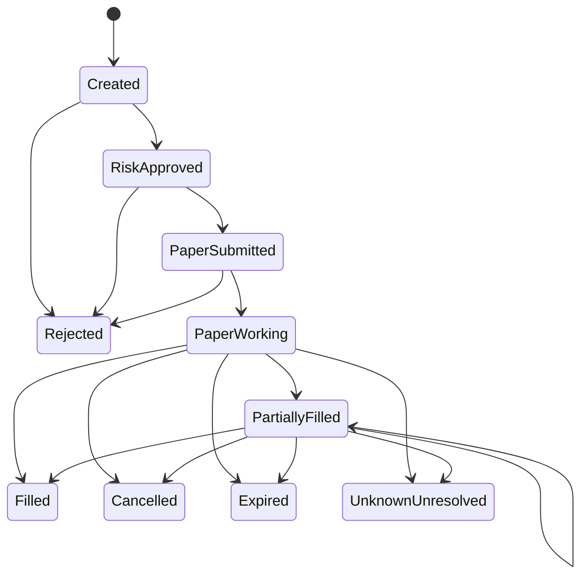

# Phase 3A: offline paper decisions and experience

This milestone runs only against a local synthetic or existing QJ01 replay. It
does not open a Dhan session, access an account, contact a cloud VM, or have any
broker order transport. The existing market journal remains authoritative and
unchanged. All paper decisions, transitions, fills and outcomes are written to a
separate checksummed QP01 ledger. Each accepted QP01 transition is `sync_data`
committed before portfolio state changes or telemetry publication. A failed
write or sync halts paper decisions; a partial last frame is truncated and
reported on recovery, while interior corruption blocks startup.

## Run locally

Rust 1.99 and Node 24 are pinned in the repository. From the repository root:

```sh
# Terminal 1: creates the 962-record synthetic fixture if absent, then replays.
cargo run --locked --release -p quant-telemetry --bin telemetry_demo \
  --manifest-path rust/Cargo.toml -- \
  --journal .local/phase3a/demo.qj \
  --paper-ledger .local/phase3a/paper.qp

# Terminal 2:
npm ci --prefix web
npm run dev --prefix web
```

Open `http://127.0.0.1:5173/` and select **Paper research**. Stop each process
with Ctrl-C. The Rust gateway binds localhost only and the UI has read-only
paper APIs. `GET /api/paper` exposes the latest bounded paper snapshot. Replay
restart rereads QJ01 and the existing QP01 events by source index; it does not
duplicate accepted paper transitions. Use **new paths** to create a new fixture
and independent paper experiment. The 2023 fixture is artificial and its
timestamps are not a current market session.

## Decision and order contracts

`quant-paper::contracts` defines version 1 typed decisions, estimates, risk
assessments, order intents/events/fills, positions, portfolios, experiences,
attributions and research rewards. Monetary values are signed INR nanounits;
source and audit times are integer nanoseconds. Browser wire values use decimal
strings for exact JavaScript transport. Missing forecasts, uncertainty, fills
and outcomes are `None`, never invented zeros. The model interface returns
`NotTrained` until a separately validated artifact exists.

The transparent baseline uses current paired book features, snapshot OFI,
microprice displacement, depth imbalance, spread, rolling return volatility,
quote-derived volume completeness and feed quality. It is an **uncalibrated
hypothesis**. It does not use future candles or later replay records. The
predeclared defaults are OFI at least 1 share, microprice displacement at least
0.05 bps and imbalance at least 0.10, with an 8-share entry and 30-second
maximum hold. `AlwaysNoTrade` is the negative control. `SimpleSignal` permits
the hypothesis in simulation; `CostAwareSignal` abstains without a calibrated
gross-edge forecast; `RiskFilteredSignal` applies the independent risk gate.
None is a validated investment policy.



IDs bind session, source-record index and instrument. A duplicate source index
is ignored; a skipped source index is an error. A paper order is never sent to
the venue. The simulator handles cash-equity long entries and exits only.
At session end, working orders expire and entry decisions halt; any remaining
position stays open and is not booked as a realized gain or loss.

## Costs, fills and accounting

The configurable, **provisional** [Dhan NSE delivery schedule](https://dhan.co/pricing/)
was checked against the public tariff on 14 October 2026 and the
[NSE levy guidance](https://www.nseindia.com/static/invest/first-time-investor-sebi-turnover-fees-stt-other-levies).
The research values are ₹0 delivery brokerage, 0.0030699% NSE transaction
charge, 0.0001% SEBI fee, 0.0000001% IPFT, 0.1% STT on each delivery side,
0.015% stamp duty on buy, 18% GST on the applicable fee base and ₹12.50 DP
on a delivery sell instruction plus applicable GST. STT and stamp are rounded
to nearest rupee and other fees up to paisa in this simulator. Actual contract
note aggregation, product classification, brokerage changes and exchange fee
changes can differ. The fee schedule therefore cannot establish calibrated
net profitability. The opportunity estimate adds spread crossing, slippage,
market impact, partial-fill allowance and an adverse movement scenario. With
no forecast model, predicted gross and net edge remain unavailable.

Paper marketable fills wait at least one source event after intent creation,
cross the then-visible spread, respect a price collar and at most 10% of the
opposite top-level displayed quantity in the base scenario. The adverse case
uses 2% participation and higher slippage. An optimistic scenario is diagnostic
only. A passive touch alone never proves a fill because queue position is
unknown. Aggregated depth does not reveal individual additions, cancellations,
trade matches, hidden liquidity or the actual queue. The simulator does not
claim displayed quantity is guaranteed available.

Cash changes on **simulated** fills only. Buy fills debit quantity × fill
price plus buy fees and add that amount to position cost basis. Sell fills
credit quantity × fill price less sell fees; realized P&L equals net proceeds
less the proportionally allocated cost basis. Buy orders reserve collar-priced
cash plus estimated buy fees until terminal. Open positions are marked at
current bid less estimated sell fees, and drawdown is from peak marked equity.
`fees_paid` counts actual simulated fill charges; it is already embedded in
realized and marked P&L. DP is charged once per sell order across partial fills.
All fees and order quantities are hypothetical.

## Independent risk and learning records

Default paper capital is ₹20,000, deployed cap ₹15,000, per-instrument cap
₹5,000, at most three positions, max estimated loss ₹200 per decision and
₹500 per session. Spread cap is 25 bps, data age 2 seconds, assumed slippage
20 bps, rolling return-volatility cap 1%, and order age 10 seconds. No
leverage, margin, short sales or derivatives are allowed. Duplicate orders,
feed disconnects, journal failures and halts block new entries. The untrained
signal is allowed **only in this paper research mode**, and that caveat is
recorded with each decision. A model cannot override hard risk rules.
The cockpit's remaining session loss allowance includes realized P&L and
currently marked unrealized P&L; it is unavailable if any open position lacks
a defensible mark. Entries are blocked while an existing position lacks a mark.

`load_experiences` joins QP01 decisions to paper orders, partial fills and
outcomes by deterministic IDs. Rejected and NO TRADE decisions remain as
records with no fictitious fill. An observed outcome is labelled simulated and
unattributable where the synthetic path cannot distinguish skill from chance.
Prediction, execution-cost and risk-model errors remain unavailable without
validated forecasts and independent actual outcomes. The reward contract is in
INR nanounits. It returns no outcome reward for abstentions; its default extra
penalty coefficients are zero to avoid arbitrary double counting. Future
experiments can configure dimensionless ppm penalties against documented
downside, drawdown, turnover and execution-cost inputs. No online RL training
occurs here.

## Offline evaluation and measurement boundaries

First create the fixture through the local demo, then stop it and run:

```sh
cargo run --locked --release -p quant-telemetry --bin paper_eval \
  --manifest-path rust/Cargo.toml -- \
  --journal .local/phase3a/demo.qj \
  --output-dir .local/phase3a/eval-NEW-NAME
```

The output directory must be new. It contains one QP01 ledger and raw JSONL
latency file per policy, plus `summary.json`. All four policies replay the
identical QJ01 records in source order. Timings use a monotonic clock. The
reported slices are QJ01 read/decode, feature update, candidate and cost
evaluation, risk evaluation, OMS/marking logic, QP01 serialization/write/fsync,
paper snapshot materialization and telemetry publication. QP01 transition
write samples are also kept individually. Summary percentiles use nearest-rank
and omit p99.9 below 1,000 samples. Browser reception and live feed decode are
unmeasured. Because the source QJ01 is already durable, these measurements
exclude market capture fsync; they must not be used as a live ingestion claim.

The synthetic fixture checks contracts and state transitions. Future model
training needs real quality-controlled sessions, chronological train,
validation and held-out test splits, plus purging/embargo for overlapping
decision horizons. Calibrate execution costs against real read-only market
data and contract notes before interpreting net paper results. An independent
out-of-sample result is required before any model promotion. Actual
profitability is **UNKNOWN**.

### Local measurement, 15 October 2026

Three sequential release-mode runs on local macOS arm64 replayed the same
962-record, two-instrument synthetic QJ01 fixture. The local cockpit and other
build/test processes were stopped during these runs. Approximate fixture rate
is 8 journal records per simulated second; live Dhan peak rate is unknown.
The full raw QJ01, all four QP01 ledgers, per-record JSONL and summaries for
each run are preserved in
[`docs/benchmarks/phase3a-isolated-2026-10-15`](../../docs/benchmarks/phase3a-isolated-2026-10-15/README.md),
with SHA-256 checksums. These measurements are **local replay only**, not
Utho, Dhan, live-feed, broker-order or browser-pixel latency.

| Policy | Unpaced records/s across runs | Paper fills / closed outcomes per run | Realized simulated P&L after fees | QP01 transition write p99 range |
| --- | ---: | ---: | ---: | ---: |
| Always NO TRADE | 728–789 | 0 / 0 | ₹0 | 5.54–10.45 ms |
| Simple signal | 426–446 | 94 / 8 | −₹148.40 | 4.00–6.27 ms |
| Cost aware | 697–757 | 0 / 0 | ₹0 | 4.47–7.26 ms |
| Signal plus risk | 418–451 | 94 / 8 | −₹148.40 | 4.06–6.61 ms |

No policy has a trained return model. The cost-aware policy correctly abstains
when estimated gross edge is unknown. The simple and risk-filtered policies
made the same hypothetical decisions because no additional risk limit bound
this fixture. The ₹148.40 paper loss includes ₹134.96 in modelled fill fees;
it does not imply a real-world loss or a statistically meaningful backtest.
The QP01 p99 figures are for complete transition append calls (serialization,
write and `sync_data`), not isolated kernel fsync time. Each paper decision
generates a durable ledger event, so fsync dominates this local throughput.
The pre-existing QJ01 capture bottleneck remains unchanged. This fixture is
too small for per-policy p99.9 write latency (240 or 500 transition samples).
